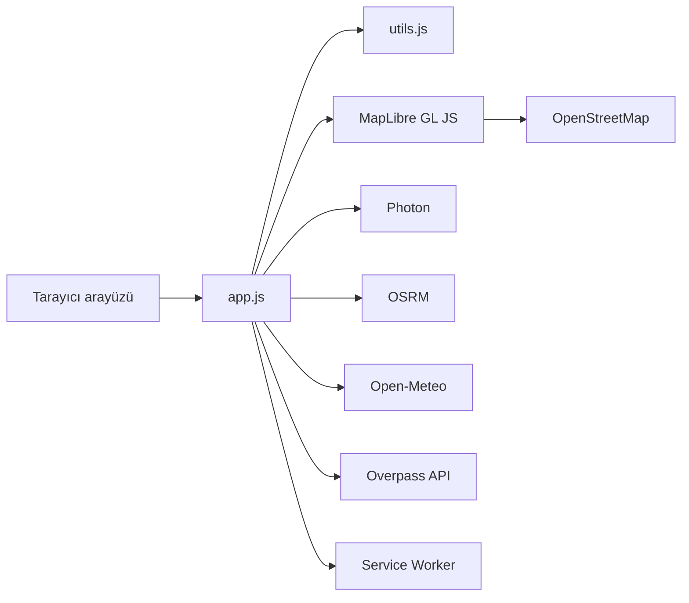

# İstanbul Açık Ulaşım ve Hava Kokpiti

Tarayıcıda çalışan, yabancı ve açık kaynaklı servislerle İstanbul ulaşımını, canlı havayı ve ulaşım verilerini tek kokpitte toplayan çevrimdışı kullanılabilir bir PWA.

Canlı demo: `https://eerrgin.github.io/istanbul-cockpit/` (yer tutucu)

Ekran görüntüsü: `docs/ekran-goruntusu.png` (yer tutucu)

## Özellikler

- Çok modlu rota planlama: yürüme, bisiklet ve araba
- Canlı hava durumu ve saatlik tahmin
- Toplu taşıma hatları ve duraklar
- En yakın durak bulma
- Duraklar arası istemci tarafı rota
- Çevrimdışı PWA desteği
- Koyu ve açık tema
- Tamamen yabancı açık kaynak servisler

## Kullanılan teknolojiler

| Teknoloji | Rol |
| --- | --- |
| MapLibre GL JS | Harita görüntüleme ve katmanlar |
| OpenStreetMap | Raster harita karoları |
| Photon (Komoot) | Yazarken adres arama |
| Open-Meteo | Canlı hava ve saatlik tahmin |
| OSRM / FOSSGIS routing | Yürüme, bisiklet ve araba rotası |
| Overpass API | Metro, tramvay ve vapur hatları |
| Vanilla JavaScript | Arayüz ve orkestrasyon |
| Vitest | Saf fonksiyon testleri |
| GitHub Actions | Sürekli test |

## Mimari



## Kurulum

Proje derleme gerektirmez. ES modülleri `file://` adresinde engellendiği için basit bir statik sunucu kullanın:

```bash
python3 -m http.server 8080
```

Ardından tarayıcıda `http://127.0.0.1:8080` adresini açın.

## Test

```bash
npm install
npm test
```

Kapsam raporu için `npm run coverage`.

## Katkı

Küçük ve odaklı değişiklikler tercih edilir. Yeni veri kaynağı eklemeden önce lisansın açık olduğunu ve Türkiye kaynaklı bir servis olmadığını doğrulayın. Saf hesapları `utils.js` içinde tutun ve testi olmadan birleştirmeyin.

## Lisans

MIT. Metin `LICENSE` dosyasındadır.

## Atıf

- OpenStreetMap: © OpenStreetMap contributors. Harita ve ulaşım geometrisi Open Database License (ODbL) altındadır. https://www.openstreetmap.org/copyright
- Open-Meteo: Hava verisi Open-Meteo.com tarafından sağlanır, CC BY 4.0. https://open-meteo.com/
- OSRM / FOSSGIS: Yaya, bisiklet ve araç yönlendirmesi. Yol ağı verisi © OpenStreetMap contributors. https://routing.openstreetmap.de/about.html
- Overpass API: Toplu taşıma ilişkileri genel kapsamlı Overpass örneklerinden sorgulanır. Veri © OpenStreetMap contributors. https://overpass.private.coffee/
- Photon by Komoot: Adres araması; veri © OpenStreetMap contributors, ODbL. https://photon.komoot.io/
- MapLibre GL JS: BSD 3-Clause. https://maplibre.org/

Bu kokpit Türkiye kaynaklı hiçbir API, veri seti, CDN, font veya ikon paketi kullanmaz. Tüm veri kaynakları yabancı operatörler tarafından sunulur ve açık lisanslıdır.
