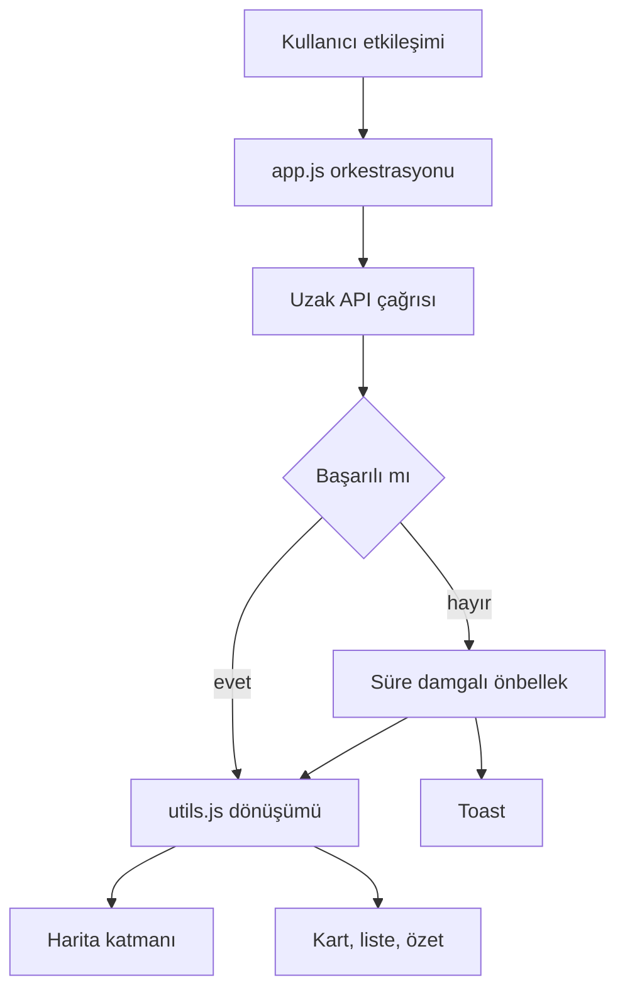

# Mimari

İstanbul Açık Ulaşım ve Hava Kokpiti tek sayfalık bir istemcidir. Derleme adımı yoktur. `index.html` statik bir sunucudan açıldığında `app.js` modülü arayüzü, haritayı ve uzak servisleri yönetir. Hesaplar `utils.js` içinde saf fonksiyon olarak durur ve DOM'a bağlanmaz.

## Katmanlar

### Tarayıcı katmanı

`index.html` ve `style.css` kokpit iskeletini kurar. Form, durak listesi, harita kabı, hava ve uçuş kartları, katman düğmeleri, çevrimdışı şeridi ve toast alanı buradadır. Metinler Türkçedir. Kullanıcı metinleri `textContent` ile yazılır.

### Harita kütüphanesi katmanı

MapLibre GL JS, İstanbul merkezli (`41.0082`, `28.9784`, zoom 11) bir raster OpenStreetMap altlığı açar. Üstüne GeoJSON kaynakları eklenir: hat çizgileri, durak daireleri, uçuş daireleri, hava noktası, hesaplanan rota ve vurgulanan durak. Katman görünürlüğü düğmelerden değiştirilir. Atıf denetimi açıktır.

### API istemci katmanı

`app.js` şu çağrıları yapar:

- Nominatim araması, en az bir saniye arayla ve yazım duraksamasıyla
- OSRM `foot`, `bike` veya `driving` profili
- Open-Meteo anlık ve saatlik tahmin
- OpenSky Network İstanbul sınır kutusu
- Overpass API metro, hafif ray, tramvay ve vapur ilişkileri

Her çağrı `AbortController` ile zaman aşımına alınır. Başarısız yanıt toast ile gösterilir. Overpass ve OpenSky için süre damgalı önbellek en az beş dakikadır; hava ve hat önbelleği on dakikadır.

### Saf utils katmanı

Mesafe, kerteriz, süre ve mesafe biçimi, WMO kodu, OpenSky satırları, Overpass GeoJSON dönüşümü, durak grafı, Dijkstra, önbellek ve GeoJSON çizgi üretimi bu katmandadır. Birim testler `tests/utils.test.js` içindedir.

### PWA katmanı

`manifest.json` kurulum bilgilerini taşır. `sw.js` statik dosyaları cache-first, çapraz kaynak GET isteklerini network-first ve önbellek yedeğiyle karşılar. Eski sürüm önbellekleri activate olayında silinir. Service worker kaydı her ortamda denenir; kayıt hatası yutulur çünkü `file://` üzerinde registration mümkün değildir.

## Veri akışı

1. Kullanıcı adres seçer, mod değiştirir veya katman açar.
2. `app.js` girdiyi doğrular ve ilgili servisi çağırır.
3. Ham JSON, utils fonksiyonlarıyla FeatureCollection, uçuş nesnesi veya grafik yoluna dönüşür.
4. Sonuç harita kaynağına veya panele yazılır.
5. Hata olursa toast açılır; taze önbellek varsa o gösterilir ve bunun da bildirimi yapılır.

## Hata yönetimi

Sessiz yakalama yoktur. Ağ hatası, HTTP durum kodu, zaman aşımı, bozuk JSON, boş rota, eksik koordinat, konum izni reddi ve bulunamayan durak kullanıcıya toast olarak gider. Service worker kaydı bu kuralın tek istisnasıdır ve kasıtlı olarak yutulur.

## Önbellek stratejisi

Uygulama önbelleği `localStorage` içine `{ value, expiresAt, savedAt }` olarak yazılır. Süresi geçen kayıt okunurken silinir. Overpass geometrisi yazmadan önce seyrekleştirilir ki kota aşılmasın. Service worker ayrıca statik kabuğu ve başarılı CORS yanıtlarını Cache API'de tutar. Çevrimdışı bayrağı `navigator.onLine` ve `online` / `offline` olaylarıyla yönetilir.
